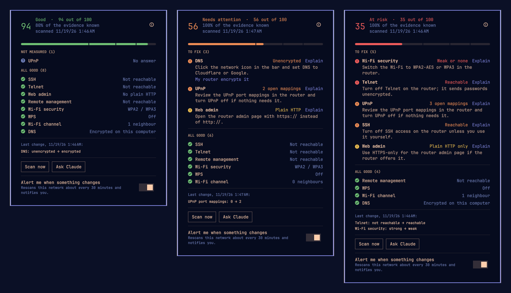
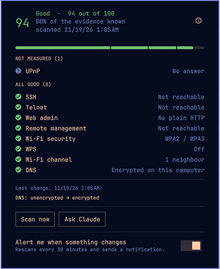
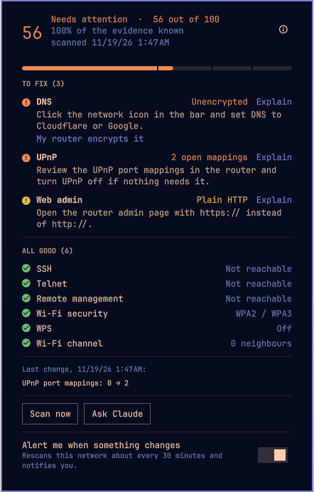
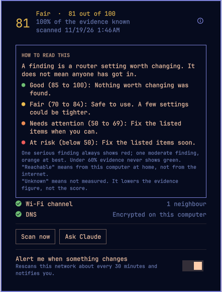
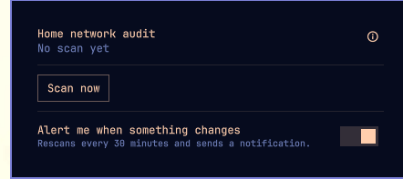

# Home network audit

Is your home router set up safely? Most people never find out. This Omarchy
bar widget checks it for you, gives the answer as one colour in the bar, and
tells you in plain words what to change.



## Why you would want it

A home router is the one device between everything you own and the internet,
and it is usually left exactly as it came out of the box. The settings that
matter are spread over admin pages most people open once, and nothing tells
you when one of them is wrong, or when it changes later.

This plugin answers three questions without you opening the router:

- **Is anything risky switched on?** Old remote-login services such as Telnet
  and SSH, provider remote management, and WPS, the join-by-button feature.
- **Can devices open doors by themselves?** With UPnP on, any gadget on your
  network can ask the router to open a port to the internet. The plugin shows
  whether UPnP is on and how many ports are open right now.
- **Is your traffic protected?** Whether the Wi-Fi uses modern encryption, and
  whether this computer's DNS lookups, the list of every site you visit, are
  sent encrypted.

## What you get

- **One glance.** A shield in the bar with a score out of 100, in green,
  yellow, orange or red.
- **What to do, not just what is wrong.** Each finding comes with the fix in
  one sentence, written for someone who does not manage networks for a living.
- **An explanation when you want one.** *Explain* hands a finding to your
  Omarchy default coding agent, which walks you through it for your router.
- **A heads-up when something changes.** Switch on alerts and you get a
  notification if a port opens, a device adds a UPnP mapping, or the Wi-Fi
  security changes.
- **No scare tactics.** A finding is a setting worth changing. It does not
  mean anyone has got in, and the popup says so.

## What it is not

- Not a vulnerability scanner: it does not look for bugs in the router's
  software or check whether its firmware is up to date.
- Not a device list: it does not show who is on your network.
- Not a view from outside: it sees the router from inside your home, so it
  cannot tell you what the internet can reach.

## Screenshots

The shield in the bar takes the colour of the verdict:


| Good | Fair |
|---|---|
|  |  |

| Needs attention | At risk |
|---|---|
|  |  |

| How to read the score | Before the first scan |
|---|---|
|  |  |

All screenshots use made-up results.

## What it checks

| Check | How |
|---|---|
| SSH, Telnet, web admin, TR-069 remote management | Connects to ports 22, 23, 80 and 7547 on the router and closes at once. Port 443 is tried too, only to see whether an HTTPS admin page exists. |
| UPnP | Asks the router which port mappings devices have opened. |
| Wi-Fi security and WPS | Reads the network this computer is joined to. |
| Wi-Fi channel | Counts other networks on the same channel. |
| DNS | Reads whether this computer encrypts its lookups, as set under the network icon in the bar. |

## What it never does

- It only ever looks at this computer's own default gateway, and only when
  that is a private address. No option accepts another target.
- It never logs in, sends credentials, reads banners or changes a setting.
- "Reachable" always means reachable from this computer, inside your home. It
  says nothing about the internet.
- The saved report holds no network names, hardware addresses, device names
  or full IP addresses.

## Requirements

- Omarchy with the Quattro shell.
- Node.js, which Omarchy provides through mise. No npm packages are used.
- `ip`, `nmcli`, `iw` and `resolvectl`, which every Omarchy system has.

## Install

```sh
omarchy plugin add https://github.com/davidkodar/omarchy-netaudit.git --enable
```

Then click the shield and press **Scan now**. A scan takes about ten seconds.
On a new system the very first one can take up to a minute, while Omarchy
installs Node.js.

## Things to know

**UPnP may read "No answer".** Omarchy's firewall drops the router's reply to
the UPnP search. The audit works without it; the check stays under Not
measured. To let that one reply through, allow it from your router only,
replacing the address with your router's:

```sh
sudo ufw allow in proto udp from 192.168.1.1 port 1900 comment 'UPnP replies from router'
```

This is the only step that needs administrator rights, and it is optional.

**DNS is measured on this computer only.** If your router encrypts DNS for the
whole home, click **My router encrypts it** on the DNS line.

**The agent buttons start your default agent the way Omarchy does**: in a
terminal, in its auto-approve mode, in a folder that holds only the report.
The prompt tells it to read the report and change nothing, but that is an
instruction, not a lock. If no default agent is set, the button opens
Omarchy's picker.

**Alerts are off until you switch them on.** When on, the widget rescans every
30 minutes and sends a desktop notification if a check changed.

## Settings

Add the router model to the widget's entry in `~/.config/omarchy/shell.json`
and the agent's steps will fit your router:

```json
{ "id": "davidkodar.netaudit", "router": "Your router brand and model" }
```

Move the widget with:

```sh
omarchy bar move davidkodar.netaudit --section right
```

## How the score works

Each check that could be measured adds its weight; points are earned when the
check passes. Checks that could not be measured count for nothing either way,
and the popup shows how much of the evidence was known.

| Check | Weight | Full points when |
|---|---|---|
| SSH, Telnet, web admin, TR-069 | 6, 10, 4, 10 | not reachable |
| UPnP | 20 | 10 when on with no mappings, 0 with mappings; not counted when it does not answer |
| Wi-Fi security | 20 | WPA2 or WPA3 |
| Wi-Fi channel | 10 | no neighbours; 5 for one or two |
| DNS | 20 | encrypted |

Good is 85 and up, Fair 70 to 84, Needs attention 50 to 69, At risk below 50.
One serious finding always shows red, one moderate finding shows orange at
best, and a scan that measured under 60% never shows green.

## Files it keeps

| Path | What |
|---|---|
| `~/.local/state/netaudit/` | The latest report and the one before it |
| `~/.config/netaudit/settings` | Your two choices: DNS declared by you, alerts on or off |

## Remove

```sh
omarchy plugin remove davidkodar.netaudit
rm -rf ~/.local/state/netaudit ~/.config/netaudit
```

If you added the firewall rule:

```sh
sudo ufw delete allow in proto udp from 192.168.1.1 port 1900
```

## Languages

Every string the widget shows lives in `i18n/en.json`. To add a language, copy
it to that language's Omarchy code, such as `sv.json`, and translate the
values. Anything left out falls back to English. Notifications and the agent
prompt are English only.

## Development

```sh
node --test tests/
omarchy plugin validate .
```

The scanner also runs by itself: `node scanner/scanner.mjs --help`.

## License

MIT
