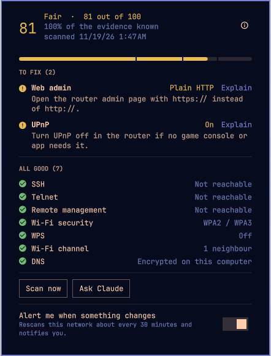
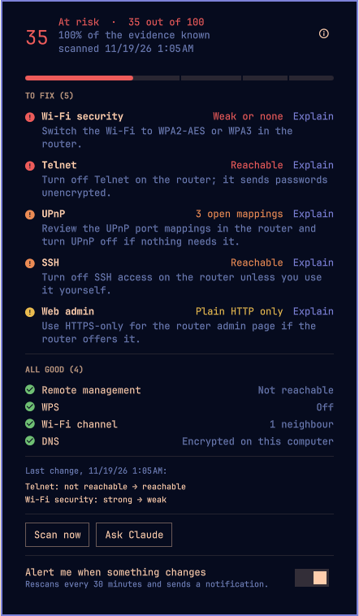

# Home network audit

Is your home router set up safely? Most people never find out. This Omarchy
bar widget checks it for you, gives the answer as one colour in the bar, and
tells you in plain words what to change.


## Why you would want it

A home router is the one device between everything you own and the internet,
and it is usually left exactly as it came out of the box. The settings that
matter are spread over admin pages most people open once, and nothing tells
you when one of them is wrong, or when it changes later.

This plugin answers three questions without you opening the router:

- **Is anything risky switched on?** Old remote-login services such as Telnet
  and SSH, provider remote management, and WPS, the join-by-button feature.
- **Can devices open doors by themselves?** With UPnP on, any gadget on your
  network can ask the router to open a port to the internet. The plugin shows
  whether UPnP is on and how many ports are open right now.
- **Is your traffic protected?** Whether the Wi-Fi uses modern encryption, and
  whether this computer's DNS lookups, the list of every site you visit, are
  sent encrypted.

## What you get

- **One glance.** A shield in the bar with a score out of 100, in green,
  yellow, orange or red.
- **What to do, not just what is wrong.** Each finding comes with the fix in
  one sentence, written for someone who does not manage networks for a living.
- **An explanation when you want one.** *Explain* hands a finding to your
  Omarchy default coding agent, which walks you through it for your router.
- **A heads-up when something changes.** Switch on alerts and you get a
  notification if a port opens, the number of UPnP mappings changes, or the
  Wi-Fi security changes.
- **No scare tactics.** A finding is a setting worth changing. It does not
  mean anyone has got in, and the popup says so.

## What it is not

- Not a vulnerability scanner: it does not look for bugs in the router's
  software or check whether its firmware is up to date.
- Not a device list: it does not show who is on your network.
- Not a view from outside: it sees the router from inside your home, so it
  cannot tell you what the internet can reach.

## Screenshots

The shield in the bar takes the colour of the verdict:


| Good | Fair |
|---|---|
|  |  |

| Needs attention | At risk |
|---|---|
|  |  |

| How to read the score | Before the first scan |
|---|---|
|  |  |

All screenshots use made-up results.

## What it checks

| Check | How |
|---|---|
| SSH, Telnet, web admin, TR-069 remote management | Connects to ports 22, 23, 80 and 7547 on the router and closes at once. Port 443 is tried too, only to see whether an HTTPS admin page exists. |
| UPnP | Asks the router which port mappings devices have opened. |
| Wi-Fi security and WPS | Reads the network this computer is joined to, and counts it only when that Wi-Fi belongs to the router being audited. |
| Wi-Fi channel | Counts other networks on the same channel. |
| DNS | Reads whether this computer's resolver encrypts its lookups, and whether it can fall back to unencrypted. |

## Limits it keeps to

- **One target.** It looks only at the router this computer's traffic really
  leaves through, as the kernel decides it, and only when that is a private
  IPv4 address one hop away on a real network card (cable or Wi-Fi). No
  option accepts another target.
- **No VPNs, tunnels or virtual networks.** It refuses to run when a default
  route, or one of the very wide routes VPNs use in its place, IPv4 or IPv6,
  in any routing table, goes through anything but a real network card: a VPN
  or tunnel, including ones that look like a cable (tap devices, ZeroTier), a
  bridge, or a virtual machine network. The route is checked before a scan
  and again after it, and a scan during which it changed is thrown away. A
  computer whose own connection runs through a bridge, a bond or a VLAN is
  refused as well. A phone's USB tethering counts as a network card, and the
  phone as the router.
- **Straight to the router.** Every connection starts from this computer's
  address on the router's link, goes to the router's IP address, ignores
  proxy settings and follows no redirects.
- **Only Scan now starts scanning a network.** It audits the router of
  whatever network this computer is on, and the plugin cannot know that the
  network is yours, so press it only on a network you own or are allowed to
  check. Alerts can be switched on only for a network you have already
  scanned, and never scan any other. The DNS links only re-score the saved
  report. When the saved report is from a different network than the one you
  are on, the popup says so, provided it can tell which network that is; the
  icon in the bar keeps showing the last report either way.
- **Read-only.** It never logs in, never sends a user name or password, reads
  no banners and makes no request meant to change a setting. The only UPnP
  action it sends is the one that reads a port-mapping entry.
- **"Reachable" means from this computer**, inside your home. It says nothing
  about the internet.
- **Nothing identifying is saved.** The report holds no network names,
  hardware addresses, device names or full IP addresses; it does hold the
  first three numbers of the router's address. To tell one network from
  another it keeps a scrambled id, a salted hash of the router's hardware
  address. The salt is stored beside it, so someone who can read both files
  could work the address out; both are readable only by you. A network that
  copies your router's hardware address would be taken for yours.

## What it sends, and when

Nothing is sent until you press **Scan now**, or switch on alerts. Installing
the plugin and opening the popup send nothing. While idle the widget starts
no process at all: it watches its saved report and settings files and rereads
them when they change. Opening the popup starts the scanner in a mode that
only reads this computer's own routing and neighbour tables, to see which
network it is on. That sends nothing; the first time, it creates the `salt`
file described under "Files it keeps".

One scan sends:

- to the router: up to three connection attempts to each of ports 22, 23, 80,
  443 and 7547, closed as soon as they connect;
- to the local network: a UPnP search to the multicast address
  `239.255.255.250:1900`, sent a few times. Every device on the local network
  can see it; it does not leave the local network;
- to the router, only if it answers that search: one request for its UPnP
  description, and one request per port-mapping entry.

The description's address comes from the router's reply to the search, and
any device on your network could forge that reply. The scanner therefore
accepts only a plain address on the router itself (no credentials, no query
string, port 80 or an unprivileged port) and reads the result only if it is
a UPnP description. A forged reply can still make it fetch another plain page
from the router. A router whose UPnP address does not have that plain form is
listed as not measured.

**Scan now** also asks NetworkManager for a fresh list of nearby Wi-Fi
networks, which makes the Wi-Fi card look for them, as opening the Wi-Fi menu
does. The background check uses the list NetworkManager already has and
causes no such search. A scan contacts nothing on the internet, with
one exception: on a system where Node.js has never been used, the first
**Scan now** makes Omarchy's tool manager (mise) download and install Node.js.
Only Scan now can do that; the popup, the DNS links and the background check
use Node.js only if it is already installed.

With alerts on, a scan runs about every 30 minutes while the bar is running,
and only on the network you switched them on for. It sends the same as Scan
now, except that it uses the Wi-Fi list NetworkManager already has. On any other
network, such as a cafe or an office, the background check sends nothing: it
looks at the local tables, sees another network and stops.

**Explain** and **Ask …** open your default coding agent in a terminal. From
then on the agent talks to its own provider as it always does. It is given a
copy of the saved report, without the network id.

## Requirements

- Omarchy with the Quattro shell.
- Node.js, which Omarchy provides through mise. No npm packages are used.
- `ip`, `nmcli`, `iw` and `resolvectl`, which every Omarchy system has.

## Install

```sh
omarchy plugin add https://github.com/davidkodar/omarchy-netaudit.git --enable
```

Then click the shield and press **Scan now**. A scan takes about ten seconds.
On a new system the very first one can take up to a minute, while Omarchy
installs Node.js.

## Things to know

**UPnP usually reads "No answer".** Omarchy's firewall drops the router's
reply to the UPnP search, so the check stays under Not measured. That is
expected: it earns no points and costs none, and every other check works
without it. This plugin never changes the firewall and never asks for
administrator rights. Your router's own admin page or app shows whether UPnP
is on and which ports it has opened.

**DNS is measured on this computer only**, from what systemd-resolved reports
about itself, and only strict DNS over TLS on every link and server that
report shows in use counts as encrypted. Omarchy's
Cloudflare and Google settings use the opportunistic mode, which encrypts
when the server allows it but can fall back to unencrypted without saying so;
that is listed as "Can fall back" and earns half the points. Where programs
bypass systemd-resolved (a `resolv.conf` that is not its stub), DNS is listed
as not measured. If your router encrypts DNS for the whole home, click **My
router encrypts it** on the DNS line. That is your statement, not a
measurement; it is about the network the report is of, applies only on that
network, and clicking it does not scan anything.

**The agent buttons start your default agent the way Omarchy does**: in a
terminal, in its auto-approve mode, with your own rights. It starts in a new
folder that holds a copy of the report and nothing else. The prompt tells it
to read the report as data and change nothing, but that is an instruction,
not a lock. If no default agent is set, the button opens Omarchy's picker.

**Alerts are off until you switch them on.** When on, the widget rescans
about every 30 minutes and sends a desktop notification if a check changed.
Alerts belong to the network you were on when you switched them on, and can
only be switched on for a network you have scanned. To move them to another
network, scan there, then switch them off and on again.

**"Not measured" is never a pass.** If the router gives no sign of life during
a scan, its ports are listed as not measured. (A router that stopped
answering within the last half minute or so can still count as present,
because the system remembers its last answer for that long.) A UPnP search that
gets no reply is not taken to mean UPnP is off, and a port-mapping table that
could not be read to its end is not taken to be empty. None of these earns
points or raises an alert.

## Settings

Add the router model to the widget's entry in `~/.config/omarchy/shell.json`
and the agent's steps will fit your router:

```json
{ "id": "davidkodar.netaudit", "router": "Your router brand and model" }
```

Move the widget with:

```sh
omarchy bar move davidkodar.netaudit --section right
```

## How the score works

Each check that could be measured adds its weight; points are earned when the
check passes. Checks that could not be measured count for nothing either way,
and the popup shows how much of the evidence was known.

| Check | Weight | Full points when |
|---|---|---|
| SSH, Telnet, web admin, TR-069 | 6, 10, 4, 10 | not reachable |
| UPnP | 20 | 10 when on with no mappings, 0 with mappings; not counted when it does not answer |
| Wi-Fi security | 20 | WPA2 or WPA3 only; a network that still accepts the first WPA, WEP or no password gets none |
| Wi-Fi channel | 10 | no neighbours; 5 for one or two |
| DNS | 20 | encrypted (strict); 10 when it can fall back to unencrypted |

Good is 85 and up, Fair 70 to 84, Needs attention 50 to 69, At risk below 50.
One serious finding always shows red, one moderate finding shows orange at
best, and a scan that measured under 60% never shows green.

## Files it keeps

| Path | What |
|---|---|
| `~/.local/state/netaudit/` | The latest report, the one before it, a random `salt` used to scramble the network id, and a `lock` file that keeps two scans from running at once |
| `~/.config/netaudit/settings` | Your choices (DNS declared by you, alerts on or off) and the scrambled ids of the networks they apply to |

## Remove

```sh
omarchy plugin remove davidkodar.netaudit
rm -rf ~/.local/state/netaudit ~/.config/netaudit
```

If the first Scan now installed Node.js, it stays: it is Omarchy's own copy,
kept by mise under `~/.local/share/mise/installs/node`, and other tools use
it too.

Each use of Explain or Ask leaves a small `netaudit-explain.*` folder holding
a copy of the report in your session's runtime directory, which the system
clears when you log out (in `/tmp` if the session has no runtime directory).

## Languages

Every string the widget shows lives in `i18n/en.json`. To add a language, copy
it to that language's Omarchy code, such as `sv.json`, and translate the
values. Anything left out falls back to English. Notifications and the agent
prompt are English only.

## Development

```sh
node --test tests/
omarchy plugin validate .
```

The scanner also runs by itself: `node scanner/scanner.mjs --help`. Run by
hand it keeps to the same limits, but unlike the widget's helper it has no
overall time limit and takes no lock.

## License

MIT
